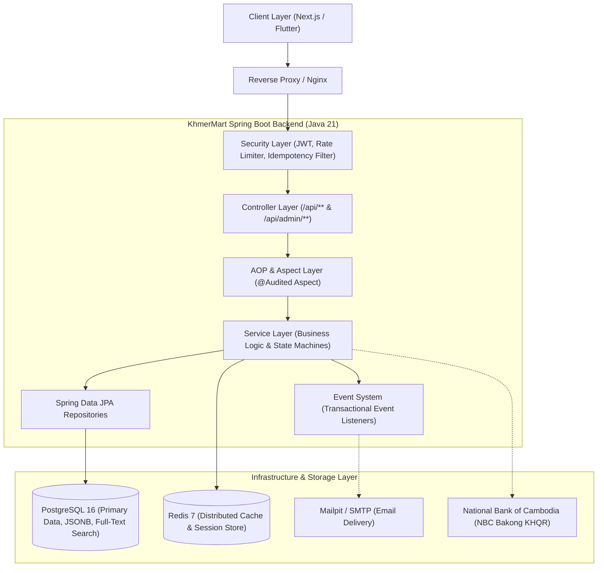
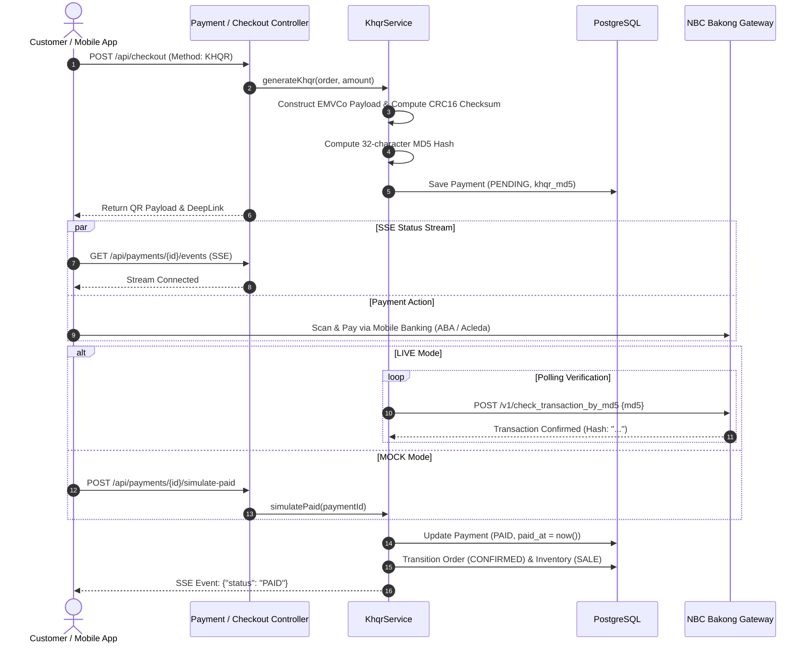

# KhmerMart Architecture: Package-by-Layer Guide

KhmerMart backend follows a strict **Package-by-Layer** architectural pattern under root package `com.khmermart`.

## Directory Structure

```
src/main/java/com/khmermart/
├── KhmerMartApplication.java
├── common/
│   ├── constant/               # Centralized constants
│   │   ├── AppConstant.java
│   │   └── MessageConstant.java
│   ├── exception/              # Custom exceptions and exception handling
│   │   ├── CustomException.java
│   │   ├── ErrorCode.java
│   │   └── GlobalExceptionHandler.java
│   └── response/               # Standard response envelopes
│       ├── ErrorResponse.java
│       ├── PaginationResponse.java
│       ├── SuccessResponse.java
│       └── TokenResponse.java
├── config/                     # Spring configurations & beans
│   ├── AppProperty.java
│   ├── AsyncConfig.java
│   ├── CacheConfig.java
│   ├── JacksonConfig.java
│   ├── MapperConfig.java
│   ├── OpenApiConfig.java
│   ├── PasswordEncoderConfig.java
│   ├── RedisConfig.java
│   ├── SecurityConfig.java
│   └── WebConfig.java
├── controller/                 # Public & Customer REST controllers
│   ├── AddressController.java
│   ├── AppUserController.java
│   ├── AuthController.java
│   ├── CartController.java
│   ├── CategoryController.java
│   ├── CheckoutController.java
│   ├── HealthController.java
│   ├── HomeController.java
│   ├── NotificationController.java
│   ├── OrderController.java
│   ├── PaymentController.java
│   ├── ProductController.java
│   ├── PushController.java
│   ├── ReviewController.java
│   ├── SettingController.java
│   ├── ShippingMethodController.java
│   └── admin/                  # Admin backoffice controllers (/api/admin/**)
│       ├── AdminAuditLogController.java
│       ├── AdminCategoryController.java
│       ├── AdminCouponController.java
│       ├── AdminDashboardController.java
│       ├── AdminInventoryController.java
│       ├── AdminOrderController.java
│       ├── AdminPaymentController.java
│       ├── AdminProductController.java
│       ├── AdminPromotionController.java
│       ├── AdminReportController.java
│       ├── AdminReviewController.java
│       ├── AdminSettingController.java
│       └── AdminUserController.java
├── model/
│   ├── entity/                 # JPA database entities
│   │   ├── Address.java
│   │   ├── AppUser.java
│   │   ├── AppUserToken.java
│   │   ├── AuditLog.java
│   │   ├── BankTransferSlip.java
│   │   ├── Cart.java
│   │   ├── CartItem.java
│   │   ├── Category.java
│   │   ├── Coupon.java
│   │   ├── CouponRedemption.java
│   │   ├── EmailVerificationToken.java
│   │   ├── IdempotencyRecord.java
│   │   ├── Inventory.java
│   │   ├── InventoryMovement.java
│   │   ├── Notification.java
│   │   ├── Order.java
│   │   ├── OrderItem.java
│   │   ├── OrderStatusHistory.java
│   │   ├── PasswordResetToken.java
│   │   ├── Payment.java
│   │   ├── Product.java
│   │   ├── ProductImage.java
│   │   ├── ProductVariant.java
│   │   ├── Promotion.java
│   │   ├── PromotionProduct.java
│   │   ├── Province.java
│   │   ├── PushSubscription.java
│   │   ├── Refund.java
│   │   ├── Review.java
│   │   ├── Setting.java
│   │   ├── Shipment.java
│   │   ├── ShippingMethod.java
│   │   ├── TrackingEvent.java
│   │   └── Wishlist.java
│   ├── enumerate/              # Domain enums
│   │   ├── CouponRedemptionStatus.java
│   │   ├── CouponType.java
│   │   ├── InventoryMovementType.java
│   │   ├── KhqrMode.java
│   │   ├── NotificationChannel.java
│   │   ├── OrderStatus.java
│   │   ├── PaymentMethod.java
│   │   ├── PaymentStatus.java
│   │   ├── PromotionType.java
│   │   ├── ReviewStatus.java
│   │   ├── Roles.java
│   │   ├── ShipmentStatus.java
│   │   └── ShippingMethodCode.java
│   ├── request/                # Inbound request records (XxxRequest)
│   │   ├── AddressRequest.java
│   │   ├── AppUserUpdateRequest.java
│   │   ├── AuthRequest.java
│   │   ├── ForgotPasswordRequest.java
│   │   ├── PasswordRequest.java
│   │   ├── RegisterRequest.java
│   │   ├── ResetPasswordRequest.java
│   │   └── VerifyEmailRequest.java
│   └── response/               # Outbound data transfer records (XxxDto)
│       ├── AddressDto.java
│       ├── AppUserDto.java
│       ├── CategoryDto.java
│       ├── FacetsDto.java
│       ├── HealthDto.java
│       ├── ImageDto.java
│       ├── ProductCardDto.java
│       ├── ProductDetailDto.java
│       ├── PublicSettingsDto.java
│       └── VariantDto.java
├── repository/                 # Spring Data JPA repositories
│   ├── AddressRepository.java
│   ├── AppUserRepository.java
│   ├── AppUserTokenRepository.java
│   ├── AuditLogRepository.java
│   ├── CartItemRepository.java
│   ├── CartRepository.java
│   ├── CategoryRepository.java
│   ├── CouponRedemptionRepository.java
│   ├── CouponRepository.java
│   ├── EmailVerificationTokenRepository.java
│   ├── IdempotencyRepository.java
│   ├── InventoryMovementRepository.java
│   ├── InventoryRepository.java
│   ├── NotificationRepository.java
│   ├── OrderItemRepository.java
│   ├── OrderRepository.java
│   ├── PasswordResetTokenRepository.java
│   ├── PaymentRepository.java
│   ├── ProductImageRepository.java
│   ├── ProductRepository.java
│   ├── ProductVariantRepository.java
│   ├── PromotionProductRepository.java
│   ├── PromotionRepository.java
│   ├── ProvinceRepository.java
│   ├── PushSubscriptionRepository.java
│   ├── RefundRepository.java
│   ├── ReviewRepository.java
│   ├── SettingRepository.java
│   ├── ShipmentRepository.java
│   ├── ShippingMethodRepository.java
│   └── WishlistRepository.java
├── security/                   # Security infrastructure & JWT
│   ├── CookieUtil.java
│   ├── CurrentUser.java
│   ├── CurrentUserService.java
│   ├── CustomAccessDeniedHandler.java
│   ├── JwtAuthEntrypoint.java
│   ├── JwtAuthFilter.java
│   ├── JwtService.java
│   ├── LoginRateLimiter.java
│   ├── RateLimitFilter.java
│   ├── RequestIdFilter.java
│   └── UserPrincipal.java
├── service/                    # Business service interfaces
│   ├── AddressService.java
│   ├── AdminProductService.java
│   ├── AdminUserService.java
│   ├── AppUserService.java
│   ├── AppUserTokenService.java
│   ├── AuditLogService.java
│   ├── AuthService.java
│   ├── BakongApiClient.java
│   ├── CartService.java
│   ├── CategoryService.java
│   ├── CheckoutService.java
│   ├── CouponService.java
│   ├── DashboardService.java
│   ├── HomeService.java
│   ├── InventoryService.java
│   ├── InvoiceService.java
│   ├── KhqrService.java
│   ├── MailService.java
│   ├── NotificationService.java
│   ├── OrderService.java
│   ├── PaymentConfirmationService.java
│   ├── PaymentSseRegistry.java
│   ├── PricingService.java
│   ├── ProductService.java
│   ├── PromotionService.java
│   ├── PushService.java
│   ├── ReportService.java
│   ├── ReviewService.java
│   ├── SettingService.java
│   ├── ShippingMethodService.java
│   └── impl/                   # Service implementations (@Service + @Transactional)
│       ├── AddressServiceImpl.java
│       ├── AdminProductServiceImpl.java
│       ├── AdminUserServiceImpl.java
│       ├── AppUserServiceImpl.java
│       ├── AppUserTokenServiceImpl.java
│       ├── AuditLogServiceImpl.java
│       ├── AuthServiceImpl.java
│       ├── BakongApiClientImpl.java
│       ├── CartServiceImpl.java
│       ├── CategoryServiceImpl.java
│       ├── CheckoutServiceImpl.java
│       ├── CouponServiceImpl.java
│       ├── DashboardServiceImpl.java
│       ├── HomeServiceImpl.java
│       ├── InventoryServiceImpl.java
│       ├── InvoiceServiceImpl.java
│       ├── KhqrPollingJob.java
│       ├── KhqrServiceImpl.java
│       ├── MailServiceImpl.java
│       ├── NotificationEventListener.java
│       ├── NotificationServiceImpl.java
│       ├── OrderServiceImpl.java
│       ├── PaymentConfirmationServiceImpl.java
│       ├── PricingServiceImpl.java
│       ├── ProductServiceImpl.java
│       ├── PromotionServiceImpl.java
│       ├── PushServiceImpl.java
│       ├── ReportServiceImpl.java
│       ├── ReviewServiceImpl.java
│       ├── SettingServiceImpl.java
│       └── ShippingMethodServiceImpl.java
├── mapper/                     # MapStruct mappers
│   ├── AddressMapper.java
│   └── AppUserMapper.java
├── util/                       # Static utilities
│   ├── ApiResponseUtil.java
│   └── MoneyUtil.java
└── seed/                       # Startup database seeder
    └── DataSeeder.java
```

## Conventions
1. **Request DTOs:** Named `XxxRequest` as Java records with Jakarta validation annotations.
2. **Response DTOs:** Named `XxxDto` as Java records returning exact camelCase contract keys.
3. **Exceptions:** All business exceptions extend `CustomException` (`RuntimeException`), carrying `ErrorCode` and optional `Map<String, Object> details`.
4. **Service Layer:** Clean separation between interface (`com.khmermart.service`) and implementation (`com.khmermart.service.impl`).
5. **Testing:** Test package mirrors main structure (`com.khmermart.controller`, `com.khmermart.security`, etc.).

---

## System Architecture Diagram



---

## KHQR Payment Sequence Diagram



