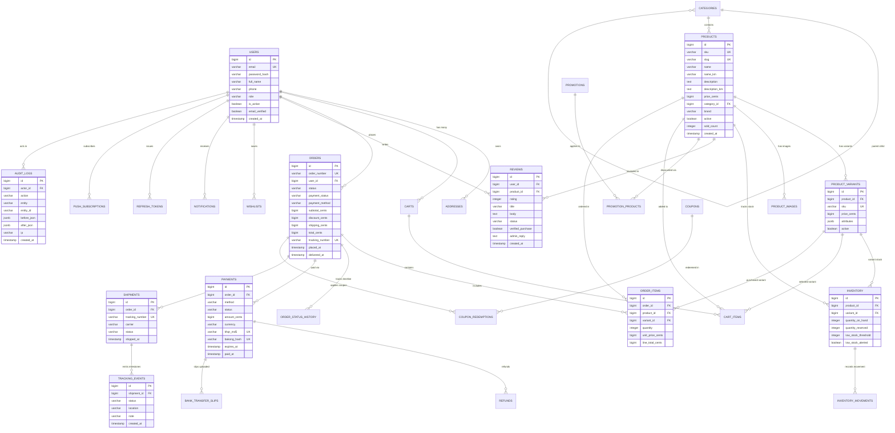

# KhmerMart Database Entity Relationship Diagram (ERD)

This document visualizes the complete database schema of KhmerMart, mapping entity relationships, cardinalities, primary keys, and foreign keys.

