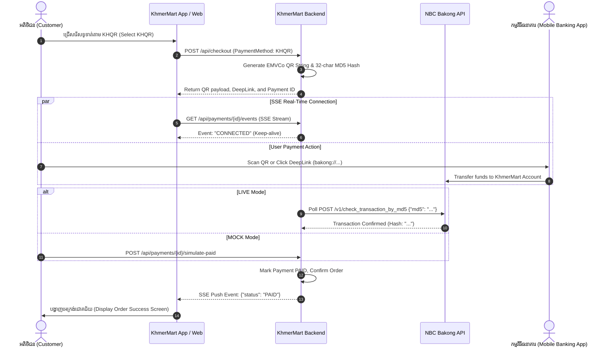

# ការតភ្ជាប់ប្រព័ន្ធទូទាត់ Bakong KHQR (KHQR Integration Guide)

This document provides a comprehensive bilingual guide (English and ខ្មែរ) explaining the National Bank of Cambodia (NBC) Bakong KHQR integration within KhmerMart.

---

## 1. ស្ថាបត្យកម្មទូទៅ (Overview & Architecture)

### English
KhmerMart implements the National Bank of Cambodia (NBC) KHQR specification based on the EMVCo standard. The platform supports both **USD** and **KHR** currencies, dynamic exchange rates, instant QR generation, deep-linking into Cambodian banking apps (ABA, ACLEDA, Canadia, Wing, etc.), real-time status streaming via Server-Sent Events (SSE), and dual operating modes (**MOCK** and **LIVE**).

### ភាសាខ្មែរ (Khmer)
KhmerMart បានអនុវត្តការតភ្ជាប់ប្រព័ន្ធទូទាត់ **Bakong KHQR** ស្របតាមស្តង់ដារ **EMVCo** របស់ធនាគារជាតិនៃកម្ពុជា (National Bank of Cambodia - NBC)។ ប្រព័ន្ធនេះគាំទ្រទាំងប្រាក់រៀល (**KHR**) និងប្រាក់ដុល្លារ (**USD**), ការបំប្លែងអត្រាប្តូរប្រាក់ស្វ័យប្រវត្តិ (Dynamic Exchange Rate), ការបង្កើតកូដ KHQR ភ្លាមៗ (Instant QR Generation), ការបើកកម្មវិធីធនាគារដោយផ្ទាល់ (**DeepLink** ទៅកាន់ ABA, ACLEDA, Canadia, Wing ។ល។), ការផ្តល់ដំណឹងស្ថានភាពទូទាត់តាមពេលវេលាជាក់ស្តែងតាមរយៈ **Server-Sent Events (SSE)**, និងដំណើរការបានពីរទម្រង់គឺ **MOCK Mode** (សម្រាប់អភិវឌ្ឍន៍ និងតេស្ត) និង **LIVE Mode** (សម្រាប់ផលិតកម្មពិតប្រាកដ)។

---

## 2. ថ្នាក់កូដស្នូល (Core Implementation Classes)

| ថ្នាក់កូដ (Java Class) | មុខងារចម្បង (Primary Responsibility) |
|:---|:---|
| [`KhqrService.java`](file:///mnt/data/Year4/SYS(1)/spring/final/khmermart/back_end/src/main/java/com/khmermart/service/KhqrService.java) | Interface កំណត់កិច្ចសន្យាបង្កើត KHQR, ការផ្ទៀងផ្ទាត់ (Verification), និងការទូទាត់សង (Refunds) |
| [`KhqrServiceImpl.java`](file:///mnt/data/Year4/SYS(1)/spring/final/khmermart/back_end/src/main/java/com/khmermart/service/impl/KhqrServiceImpl.java) | បង្កើត EMVCo Payload, គណនា CRC16, គណនា 32-character MD5 Hash, និងគ្រប់គ្រងប្រតិបត្តិការទូទាត់ |
| [`BakongApiClient.java`](file:///mnt/data/Year4/SYS(1)/spring/final/khmermart/back_end/src/main/java/com/khmermart/service/BakongApiClient.java) | HTTP Client តភ្ជាប់ទៅកាន់ Bakong Open API របស់ NBC (`https://api-bakong.nbc.gov.kh`) |
| [`PaymentController.java`](file:///mnt/data/Year4/SYS(1)/spring/final/khmermart/back_end/src/main/java/com/khmermart/controller/PaymentController.java) | Endpoints សម្រាប់ KHQR Data, SSE Stream (`/events`), Simulate Settlement, និង Slip Upload |

---

## 3. លំហូរនៃការទូទាត់ (Payment Flow & Lifecycle)

---

## 4. ទម្រង់គណនី (Individual vs Merchant Accounts)

### English
KhmerMart supports two merchant profiles:
1. **INDIVIDUAL**: Uses personal Bakong Account ID (e.g., `khmermart@aclb`). Tag 29 contains Tag 00 (`bakong_account_id@bank`).
2. **MERCHANT**: Uses Bakong Acquiring Bank & Merchant ID. Tag 30 contains Tag 00 (`merchant_id`) and Tag 01 (`acquiring_bank`).

### ភាសាខ្មែរ (Khmer)
KhmerMart គាំទ្រគណនីអាជីវកម្ម ២ ប្រភេទ៖
1. **INDIVIDUAL (គណនីបុគ្គល)**៖ ប្រើប្រាស់លេខសម្គាល់ Bakong Account ID (ឧទាហរណ៍ `khmermart@aclb`)។ នៅក្នុង EMVCo Tag 29 ផ្ទុក Tag 00 ដែលជាអាសយដ្ឋានគណនី Bakong។
2. **MERCHANT (គណនីក្រុមហ៊ុន/អាជីវកម្ម)**៖ ប្រើប្រាស់លេខកូដ Merchant ID និង Acquiring Bank។ នៅក្នុង EMVCo Tag 30 ផ្ទុក Tag 00 (`merchant_id`) និង Tag 01 (`acquiring_bank`)។

---

## 5. ការប្តូរទៅកាន់ LIVE Mode (Switching to LIVE Mode)

### English
To switch from `MOCK` mode to `LIVE` mode:
1. Obtain an official Production Access Token from NBC Bakong Developer Portal.
2. Set `KHQR_MODE=LIVE` and `BAKONG_TOKEN=<your-production-token>` in your environment variables or via `PUT /api/admin/settings`.
3. The system enforces strict validation: Switching to `LIVE` without a non-empty `BAKONG_TOKEN` immediately returns HTTP 422 `UNPROCESSABLE_ENTITY`.

### ភាសាខ្មែរ (Khmer)
ដើម្បីប្តូរពីទម្រង់សាកល្បង (`MOCK`) ទៅកាន់ទម្រង់ផលិតកម្មពិតប្រាកដ (`LIVE`)៖
1. ត្រូវស្នើសុំ **Production Access Token** ផ្លូវការពីធនាគារជាតិនៃកម្ពុជា (NBC Bakong Portal)។
2. កំណត់អថេរ `KHQR_MODE=LIVE` និង `BAKONG_TOKEN=<token_របស់លោកអ្នក>` នៅក្នុង [.env](file:///mnt/data/Year4/SYS(1)/spring/final/khmermart/back_end/.env.example) ឬតាមរយៈ Backoffice API `PUT /api/admin/settings`។
3. ប្រព័ន្ធមានសុវត្ថិភាពខ្ពស់៖ ប្រសិនបើព្យាយាមបើក `LIVE` ដោយគ្មាន `BAKONG_TOKEN` ត្រឹមត្រូវ នោះប្រព័ន្ធនឹងបដិសេធភ្លាមៗជាមួយកូដ **HTTP 422 UNPROCESSABLE_ENTITY**។

---

## 6. ការផ្សះផ្សាគណនី និងរបាយការណ៍ (Reconciliation & Audit)

### English
Backoffice administrators can invoke `GET /api/admin/payments/reconciliation` to detect discrepancies between internal payment status and Bakong settlement logs:
- **MISMATCH_STATUS**: Payment recorded as `PAID` internally but not settled in Bakong.
- **MISMATCH_AMOUNT**: Settled amount differs from the registered order amount.
- **ORPHAN_TRANSACTION**: Unmatched external transaction.

### ភាសាខ្មែរ (Khmer)
អ្នកគ្រប់គ្រងប្រព័ន្ធអាចដំណើរការផ្ទៀងផ្ទាត់បញ្ជីទូទាត់ (Reconciliation) តាមរយៈ `GET /api/admin/payments/reconciliation` ដើម្បីរកមើលភាពមិនស៊ីសង្វាក់គ្នារវាងទិន្នន័យក្នុងប្រព័ន្ធ និងទិន្នន័យជាក់ស្តែងរបស់ Bakong៖
- **MISMATCH_STATUS**៖ ស្ថានភាពក្នុងប្រព័ន្ធបង្ហាញថា `PAID` ប៉ុន្តែគ្មានកំណត់ត្រាជោគជ័យក្នុង Bakong។
- **MISMATCH_AMOUNT**៖ ចំនួនទឹកប្រាក់ដែលបានបង់ មិនស្មើគ្នានឹងចំនួនទឹកប្រាក់សរុបនៃវិក្កយបត្រ។
- **ORPHAN_TRANSACTION**៖ មានប្រតិបត្តិការផ្ទេរប្រាក់ចូល ប៉ុន្តែរកមិនឃើញលេខបញ្ជាទិញត្រូវគ្នា។
