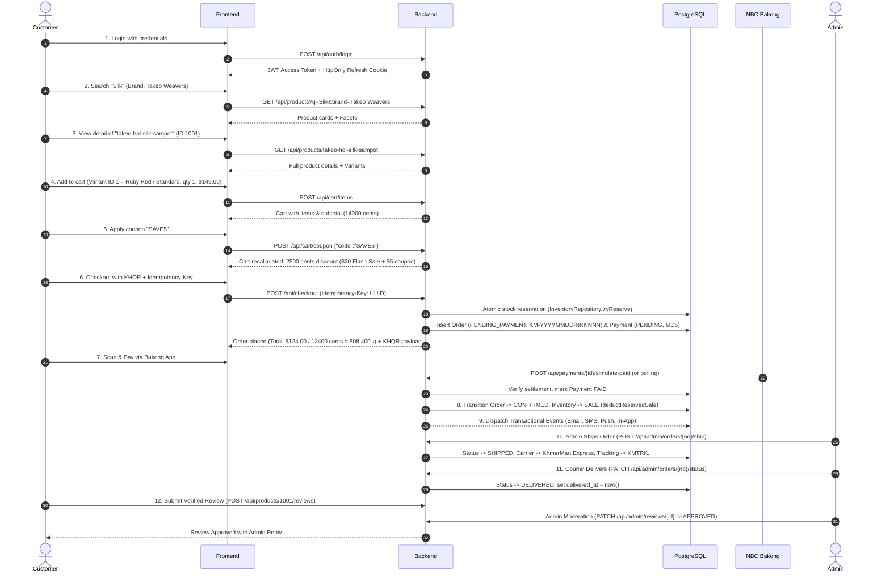

# KhmerMart 12-Step E-Commerce Purchase Flow

This document details the complete end-to-end lifecycle of an order in KhmerMart, corresponding exactly to the integration test scenario verified in [`PurchaseFlowE2ETest`](file:///mnt/data/Year4/SYS(1)/spring/final/khmermart/back_end/src/test/java/com/khmermart/controller/PurchaseFlowE2ETest.java).

---

## High-Level Sequence Diagram



---

## Step-by-Step Breakdown

### Step 1: Customer & Admin Authentication
- **Endpoint**: `POST /api/auth/login`
- **Request**: `{"email": "customer1@khmermart.local", "password": "Customer@123"}`
- **Behavior**: Verifies BCrypt password hash. Issues dual tokens:
  - 15-minute Bearer JWT access token in response body.
  - 7-day rotating refresh token in `HttpOnly`, `SameSite=Strict` cookie (`km_rt`).

### Step 2: Catalog Search & Filter
- **Endpoint**: `GET /api/products?q=Silk&brand=Takeo Weavers`
- **Behavior**: Uses PostgreSQL full-text search vector and pg_trgm similarity indexes. Returns matching product cards with real-time stock and price facets.

### Step 3: Product Detail by Slug
- **Endpoint**: `GET /api/products/takeo-hol-silk-sampot`
- **Behavior**: Fetches the complete product entity (ID 1001, "Takeo Hol Silk Sampot"), its 4 variants (color Ruby Red / Royal Blue x grade Standard 14,900 cents / Premium 19,900 cents; Variant ID 1 = Ruby Red Standard, SKU `HOL-SAMPOT-RED-STD`), the active per-variant Flash Sale 24H price (`salePriceCents` 12,900 on the two Standard variants only), and category breadcrumbs (Silk & Textiles).

### Step 4: Add to Cart
- **Endpoint**: `POST /api/cart/items`
- **Request**: `{"productId": 1001, "variantId": 1, "quantity": 1}`
- **Behavior**: Merges items into authenticated user cart (or guest session cart). Subtotal: 14,900 cents ($149.00); the cart already shows the Flash Sale 24H discount of 2,000 cents (14,900 → 12,900).

### Step 5: Apply Promotional Coupon
- **Endpoint**: `POST /api/cart/coupon`
- **Request**: `{"code": "SAVE5"}`
- **Behavior**: Validates coupon active date window, per-user usage limits, and minimum cart spend. Applies fixed $5.00 (`500 cents`) discount on top of the Flash Sale 24H discount (`2000 cents`), totaling `2500 cents` discount ($25.00 off), leaving a net total of `12400 cents` ($124.00 = 508,400 ៛ at the 4,100 ៛/$ rate).

### Step 6: Idempotent Checkout with KHQR
- **Endpoint**: `POST /api/checkout`
- **Headers**: `Idempotency-Key: <unique-uuid-v4>`
- **Request**: `{"shippingAddressId": 1, "shippingMethodCode": "STANDARD", "paymentMethod": "KHQR"}`
- **Behavior**:
  - `CheckoutServiceImpl` verifies distributed idempotency via `IdempotencyRecordRepository` (Redis + DB) to prevent double-charging.
  - Atomic stock reservation via `InventoryRepository.tryReserve(inv.getId(), item.getQuantity())`:
    ```sql
    UPDATE inventory SET quantity_reserved = quantity_reserved + :qty, updated_at = now()
    WHERE id = :id AND quantity_on_hand - quantity_reserved >= :qty
    ```
  - Creates `orders` row in `PENDING_PAYMENT` status with format `KM-YYYYMMDD-NNNNNN` (e.g. `KM-20261024-000001`).
  - Order breakdown: Subtotal $149.00 (14900 cents), Discount $25.00 (2500 cents: 2000 flash + 500 coupon), STANDARD Shipping $0.00 (0 cents, free over $50 threshold), Total $124.00 (12400 cents = 508,400 ៛).
  - Generates Bakong KHQR EMV payload and QR string, storing 32-character hexadecimal MD5 hash in `payments`.

### Step 7: Payment Settlement
- **Endpoint**: `POST /api/payments/{id}/simulate-paid` (or automated Bakong polling via `KhqrPollingJob`)
- **Behavior**: Verifies payment amount matches order total. Transitions `payments.status` to `PAID` with timestamp.

### Step 8: Order Confirmation & Inventory Sale
- **Behavior**:
  - Order status transitions strictly from `PENDING_PAYMENT` to `CONFIRMED` via `OrderStateMachine`.
  - Stock transition: `InventoryRepository.deductReservedSale` decrements `quantity_on_hand` and `quantity_reserved`.
  - Inventory movement recorded with type `SALE`.

### Step 9: Multi-Channel Notifications
- **Behavior**: Asynchronous `@TransactionalEventListener(phase = AFTER_COMMIT)` triggers:
  - Order Confirmation Email to customer.
  - Payment Receipt Email with invoice link.
  - Payment Confirmation SMS: `"Your payment of $124.00 was successful"`.
  - In-App notification stored in `notifications`.
  - Web Push notification dispatched via VAPID.

### Step 10: Admin Order Fulfillment (Ship)
- **Endpoint**: `POST /api/admin/orders/{orderNumber}/ship`
- **Request**: `{"carrier": "KhmerMart Express"}`
- **Behavior**:
  - Validates `OrderStatus.CONFIRMED` -> `SHIPPED`.
  - Generates unique tracking number (e.g., `KM-TRK-0001`).
  - Dispatches `OrderShippedEvent` sending dispatch tracking email.

### Step 11: Delivery Confirmation
- **Endpoint**: `PATCH /api/admin/orders/{orderNumber}/status`
- **Request**: `{"status": "DELIVERED", "note": "Delivered by courier to customer"}`
- **Behavior**:
  - Sets `delivered_at = now()`.
  - Records milestone in `order_status_history`.
  - Dispatches `OrderDeliveredEvent` sending email containing review call-to-action link.

### Step 12: Customer Review & Backoffice Moderation
- **Customer Endpoint**: `POST /api/products/{id}/reviews`
  - Validates verified purchase status (`orders` table contains delivered order for customer).
  - Creates review in `PENDING` status.
- **Admin Endpoint**: `PATCH /api/admin/reviews/{id}`
  - Updates review to `APPROVED` and adds admin reply: `"Thank you for your feedback!"`.
  - Recomputes average rating and review count on product 1001.
